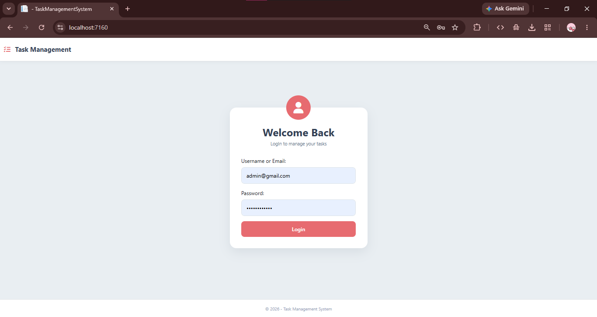
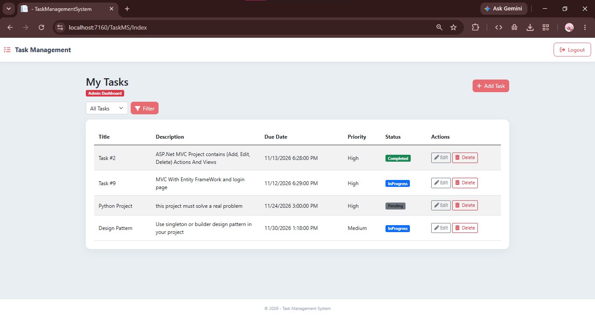
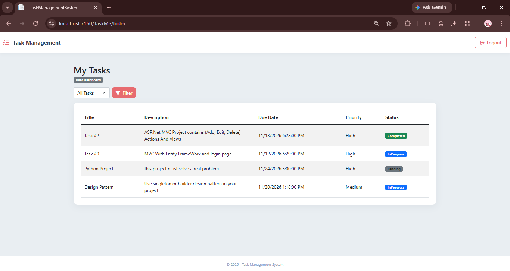
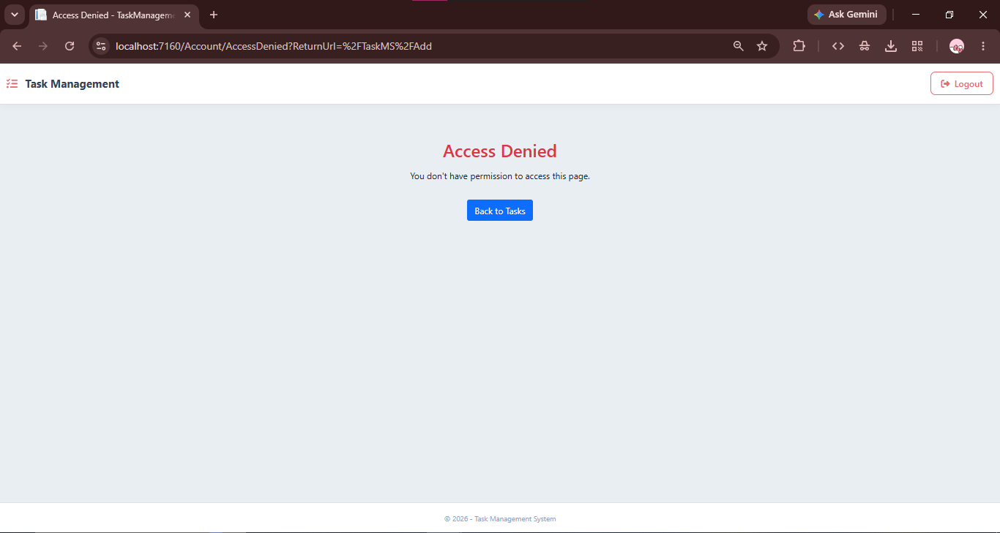
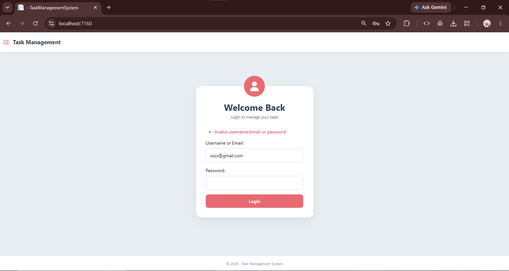

# Task Management System

A simple ASP.NET Core MVC application developed as a training project. The application allows users to view and manage tasks through a responsive interface with authentication and role-based authorization.

## Features

- View and filter tasks by status.
- Add, edit, and delete tasks (Admin only).
- Form validation.
- Responsive Bootstrap UI.
- Login using username or email and password.
- Logout functionality.
- Role-based access control.

## Technologies

- C#
- ASP.NET Core MVC
- ASP.NET Core Identity
- Entity Framework Core
- SQL Server
- Bootstrap
- HTML, CSS, and JavaScript

## Data Storage

Tasks, users, and roles are stored in SQL Server using Entity Framework Core and ASP.NET Core Identity.

## Authentication & Authorization

The application uses ASP.NET Core Identity for authentication and role-based authorization.

Users can log in using their username or email and password.

### User Roles

**Admin**
- View and filter tasks.
- Add new tasks.
- Edit existing tasks.
- Delete tasks.

**User**
- View and filter tasks.
- Cannot add, edit, or delete tasks.

Protected actions use [Authorize] and [Authorize(Roles = "Admin")] to enforce permissions.

## How to Create Users and Assign Roles

The application uses (DbInitializer) to create initial accounts and assign roles automatically.

### Step 1: Configure User Secrets

1. Open the project in Visual Studio.
2. Right-click the (TaskManagementSystem) project.
3. Select **Manage User Secrets**.
4. Add the following configuration:


```json
{
  "SeedUsers": {
    "Admin": {
      "Username": "admin",
      "Email": "admin@example.com",
      "Password": "YOUR_STRONG_ADMIN_PASSWORD"
    },
    "User": {
      "Username": "user",
      "Email": "user@example.com",
      "Password": "YOUR_STRONG_USER_PASSWORD"
    }
  }
}
```


Replace the example passwords with strong passwords that meet ASP.NET Core Identity requirements => password must be contain upper case letter.

### Step 2: Configure the Database

1. Configure the SQL Server connection string in (appsettings.json).
2. Open **Tools → NuGet Package Manager → Package Manager Console**.
3. Run:

Update-Database


### Step 3: Run the Application

When the application starts:

- DbInitializer.SeedRolesAsync() creates the (Admin) and (User) roles if they do not exist.
- DbInitializer.SeedUserAsync() creates the configured accounts if they do not exist.
- Each account is assigned its corresponding role.
- Users and roles are stored in SQL Server.

### Step 4: Log In

1. Run the application.
2. Open the Login page.
3. Enter the username or email configured in User Secrets.
4. Enter the corresponding password.
5. Click **Login**.

After successful login, the user is redirected to the My Tasks page.

## Security Features

- ASP.NET Core Identity authentication.
- Password hashing.
- Cookie-based authentication.
- Role-based authorization.
- Protected Admin-only actions.
- Anti-forgery validation for POST requests.
- Logout functionality.
- Access Denied page.

## Screenshots

### Login Page



### Admin Dashboard



### User Dashboard



### Access Denied



### Invalid Login



## Git Branch

Authentication and authorization features were developed in the (add-security-features) branch.
